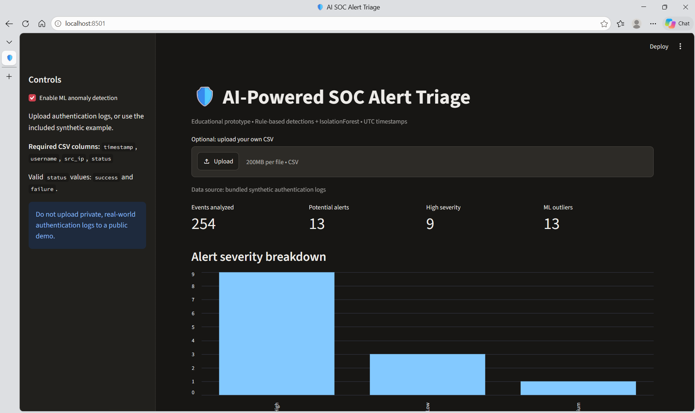
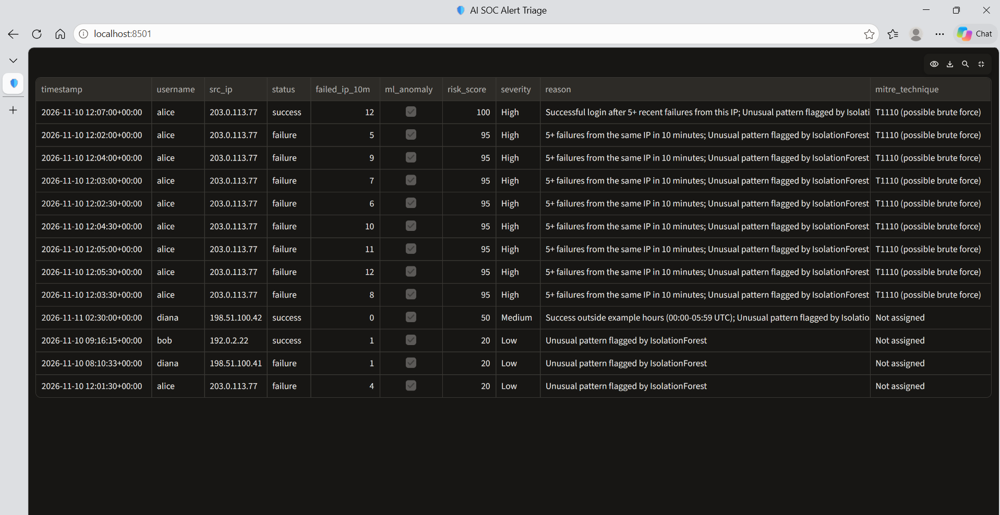

# 🛡️ AI-Powered SOC Alert Triage

A beginner-friendly cybersecurity portfolio project built with **Python, Pandas, Scikit-learn, and Streamlit**. It analyzes authentication logs, identifies **possible brute-force behavior**, uses **IsolationForest** to identify unusual events, assigns an explainable heuristic severity score, and generates a downloadable alert report.

> **Educational prototype, not a production SOC detection system.** All bundled IP addresses use RFC 5737 documentation address ranges. Data is entirely synthetic. ML anomalies and ATT&CK mappings are clues for investigation, not proof that a security incident occurred.

## Features

- Read synthetic logs or upload your own CSV (max 5 MB, max 50,000 rows).
- Detect 5+ login failures from the same IP over a rolling 10-minute window.
- Highlight a successful login after repeated failures from the same IP.
- Flag successful logins between 00:00 and 05:59 **UTC** as an illustrative heuristic.
- Add an unsupervised IsolationForest outlier indicator (requires 30+ events).
- Explain individual alerts, show severity counts, and export alerts to CSV with basic formula-injection protection.
- Display tentative **MITRE ATT&CK T1110 (Brute Force)** mapping for related events.
- Test with `pytest`; GitHub Actions runs tests on pushes and pull requests.

## Architecture

```text
CSV logs --> validation + UTC normalization --> chronological events
        --> rolling 10-min IP failure count --> detection rules
        --> IsolationForest outlier detection --> risk score + explanations
        --> Streamlit dashboard + CSV export
```

## Install and run (Windows PowerShell + VS Code)

Install Python 3.12 or 3.13, Visual Studio Code (with Microsoft's Python extension), and optionally Git. In VS Code, select **File > Open Folder** and open `ai-soc-alert-triage`. Then select **Terminal > New Terminal**. Run the following commands from inside the project folder:

```powershell
py --version
py -m venv .venv
.\.venv\Scripts\python.exe -m pip install --upgrade pip
.\.venv\Scripts\python.exe -m pip install -r requirements.txt
.\.venv\Scripts\python.exe generate_logs.py
.\.venv\Scripts\python.exe -m pytest -q
.\.venv\Scripts\python.exe -m streamlit run app.py
```

The dashboard should open at `http://localhost:8501` (or another port printed by Streamlit). Press `Ctrl+C` in the terminal to stop the server.

**Note:** Calling `.venv\Scripts\python.exe` directly avoids PowerShell's script activation policy issues; no `Activate.ps1` is required.

## CSV format

| timestamp | username | src_ip | status |
|---|---|---|---|
| 2026-11-10T12:00:00+00:00 | alice | 203.0.113.77 | failure |
| 2026-11-10T12:01:00+00:00 | alice | 203.0.113.77 | failure |

Timestamps are normalized to UTC. Accepted statuses are `success` and `failure`; IP addresses must be valid IPv4 or IPv6 strings.

## How severity works

| Rule | Points | Why |
|---|---:|---|
| 5+ failures from the same IP in 10 minutes | +75 | Possible brute-force behavior |
| Successful login after 5+ failures from same IP | +90 | Possible successful guessing (not confirmed) |
| Successful login during 00:00–05:59 UTC | +30 | Simple illustrative anomaly heuristic |
| ML outlier | +20 | IsolationForest flagged an unusual feature combination |

Scores are capped at 100: **High ≥70**, **Medium ≥40**, **Low ≥20**, and **Informational <20**. These **are not probabilities** and do not represent calibrated threat confidence.

## Testing

```powershell
.\.venv\Scripts\python.exe -m pytest -q
```

Tests check brute-force thresholds, look-back expiry, success after failures, normal activity, validation errors, CSV injection defenses, sample dataset generation, and the ML code path.

## Publish to GitHub

1. On GitHub, create an **empty** public repository named `ai-soc-alert-triage`. Do not select a starter README, .gitignore, or license.
2. In the VS Code terminal (from this project folder), run:

```powershell
git init
git add .
git commit -m "Build initial AI SOC alert triage prototype"
git branch -M main
git remote add origin https://github.com/YOUR_USERNAME/ai-soc-alert-triage.git
git push -u origin main
```

Replace `YOUR_USERNAME` with your GitHub username. If Git asks for a name/email, configure them first using `git config --global user.name "Your Name"` and `git config --global user.email "you@example.com"`. Authenticate in the browser when prompted.

## Things to improve before claiming results on a resume

- Add separately labeled, realistic **normal and attack test data**.
- Evaluate precision/recall and false-positive rate against known labels.
- Tune detectors on a separate training set; don't train and evaluate on the same events.
- Replace fixed UTC nighttime heuristics with per-user baselines and account-specific time zones.
- Add robust alert deduplication, monitoring, historical baselines, and incident review workflow.
- Add a real screenshot of the running dashboard to `docs/` and reference it here.

## Ethics and privacy

Use authorized sample data or logs you are permitted to analyze. Do not upload secrets, internal IP inventories, credentials, or identifiable production logs to a public GitHub repository. Do not treat an ML outlier or tentative MITRE mapping as proof of malicious activity.

## Interview explanation

"I built a small SOC triage tool that reads authentication logs, detects possible brute-force sequences using a rolling 10-minute window, and adds IsolationForest outlier signals. I designed an explainable scoring method and visualized alerts in Streamlit. I also wrote automated tests and enabled CI on GitHub. It's an educational prototype, and I documented its false-positive and evaluation limitations."

## Dashboard Screenshots

### Security Monitoring Dashboard


### Threat Detection Results
